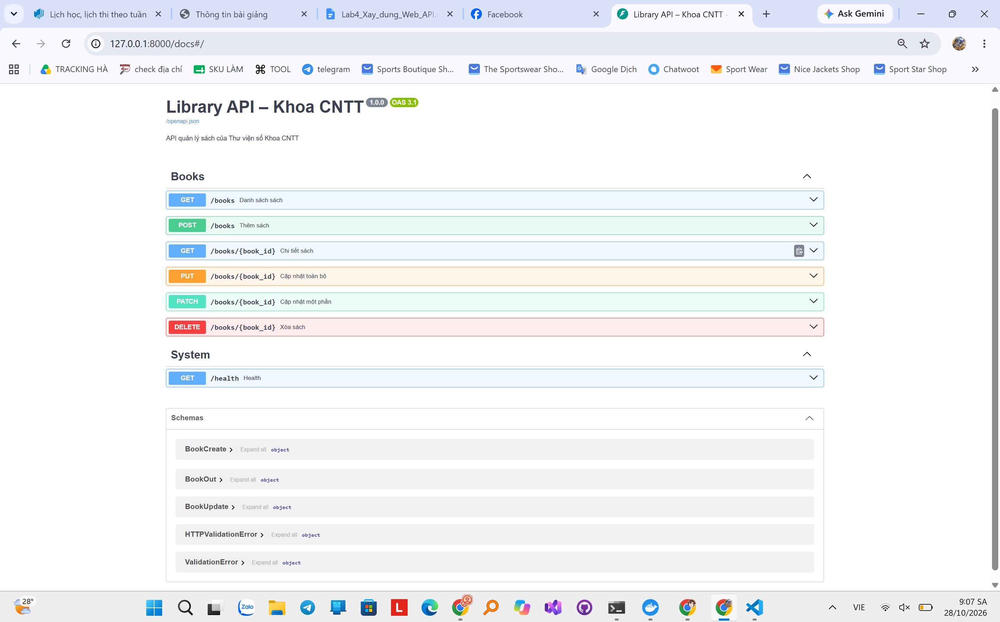
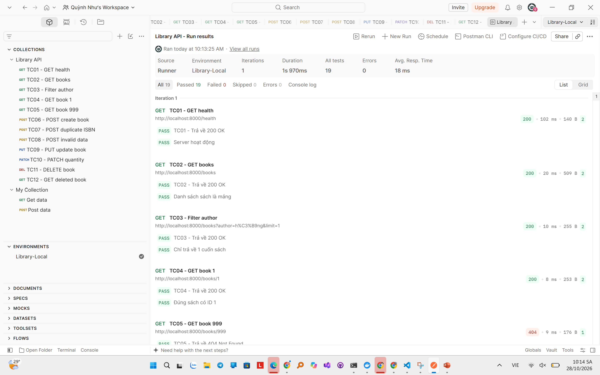

# LAB 4 - LIBRARY API

## 1. Giới thiệu dự án

Dự án xây dựng Web API CRUD quản lý sách cho Thư viện số Khoa CNTT bằng FastAPI.

Các chức năng chính:
- Xem danh sách sách.
- Tìm kiếm sách theo tên hoặc tác giả.
- Phân trang danh sách sách.
- Xem chi tiết sách theo ID.
- Thêm sách mới, kiểm tra ISBN trùng.
- Cập nhật toàn bộ thông tin bằng PUT.
- Cập nhật một phần thông tin bằng PATCH.
- Xóa sách bằng DELETE.

## 2. Công nghệ sử dụng

- Python 3.10+
- FastAPI
- Pydantic
- Uvicorn
- Postman
- Git và GitHub
- Ubuntu WSL2
- Visual Studio Code

## 3. Hướng dẫn cài đặt và chạy

Mở Terminal Ubuntu tại thư mục library-api.

Thực hiện lần lượt các lệnh:

    python3 -m venv .venv
    source .venv/bin/activate
    pip install -r requirements.txt
    uvicorn app.main:app --reload

Sau khi server chạy thành công, mở Swagger UI:

http://127.0.0.1:8000/docs

## 4. Danh sách API

| Method | Endpoint | Chức năng |
|---|---|---|
| GET | /health | Kiểm tra server |
| GET | /books | Danh sách, lọc và phân trang |
| GET | /books/{book_id} | Chi tiết sách |
| POST | /books | Thêm sách mới |
| PUT | /books/{book_id} | Cập nhật toàn bộ |
| PATCH | /books/{book_id} | Cập nhật một phần |
| DELETE | /books/{book_id} | Xóa sách |

Các mã trạng thái sử dụng:
- 200 OK
- 201 Created
- 204 No Content
- 404 Not Found
- 409 Conflict
- 422 Unprocessable Entity

## 5. Kiểm thử bằng Postman

Import hai file trong thư mục postman:

- Library-API.postman_collection.json
- Library-Local.postman_environment.json

Chọn Environment Library-Local.

Chạy Collection Runner với:
- Iterations: 1
- Run type: Functional
- Thứ tự: TC01 đến TC12

Kết quả kiểm thử:
- 12 test case
- 19/19 assertions Passed
- 0 Failed
- 0 Errors

## 6. Hình ảnh minh chứng

### Giao diện Swagger UI

### Kết quả Postman Runner

## 7. Ghi chú

Dữ liệu sách được lưu tạm thời trong bộ nhớ Python.

Khi khởi động lại server, dữ liệu trở về trạng thái ban đầu.
